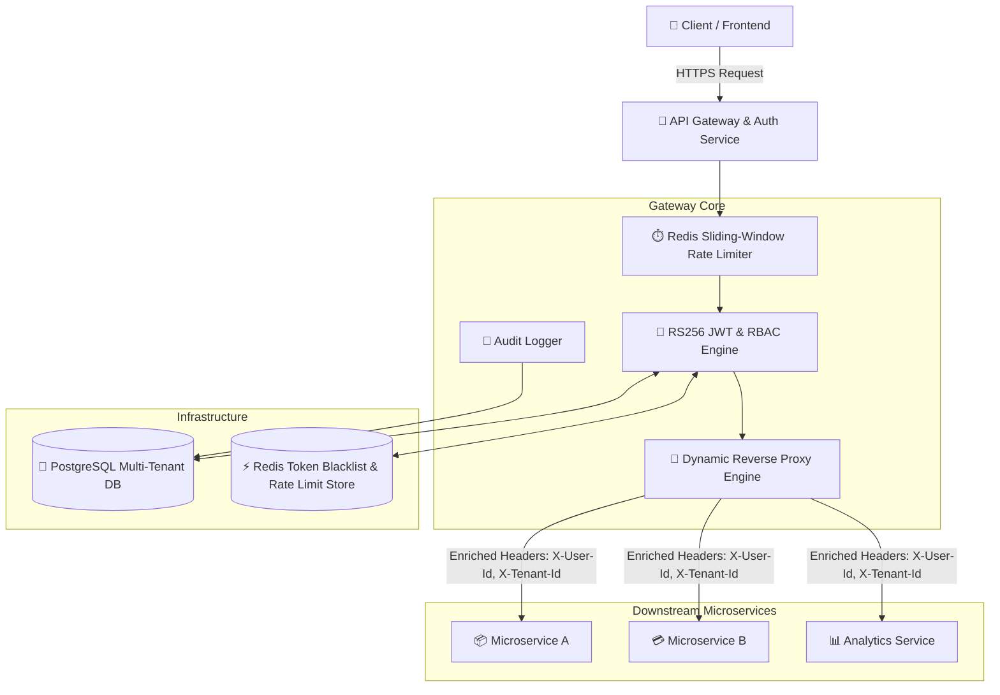
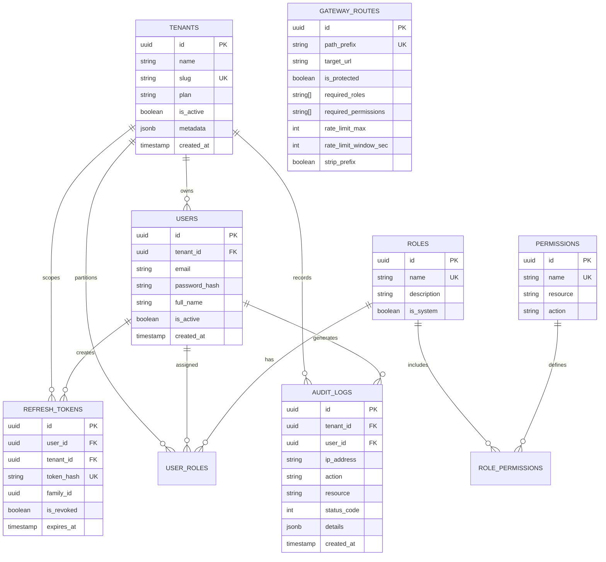
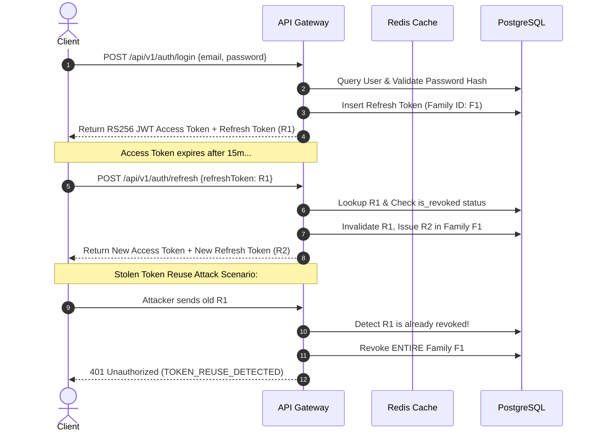

# 🛡️ Enterprise Multi-Tenant Authentication & API Gateway Service

[](https://www.typescriptlang.org/)
[](https://nodejs.org/)
[](https://www.docker.com/)
[](https://www.postgresql.org/)
[](https://redis.io/)
[](https://jwt.io/)
[](LICENSE)

A standalone, production-ready, cloud-native **Multi-Tenant Authentication and API Gateway Service** built with TypeScript, Node.js, PostgreSQL, and Redis. It provides cryptographic identity management, token rotation, distributed rate limiting, and dynamic reverse proxy routing to downstream microservices.

---

## 🏛️ System Architecture



---

## 🌟 Key Features

### 1. 🔐 Cryptographic Authentication & Security
- **RS256 Asymmetric Signing**: Access tokens are signed using a 2048-bit RSA private key and verifiable via public key or standard **JWKS** (`/api/v1/auth/jwks.json`).
- **Refresh Token Rotation & Family Reuse Detection**: Automatically tracks token lineage. If an invalidated refresh token is reused, all tokens in the family are instantly revoked.
- **Redis Token Blacklist**: Instant session termination and JTI-based token revocation with auto-expiring TTLs.
- **Tenant Isolation**: Non-SuperAdmin users are cryptographically constrained within their tenant boundaries.

### 2. 👥 Granular Multi-Tenant RBAC
Hierarchical roles and permissions matrix:
- **`SuperAdmin`**: Platform-wide cross-tenant control, tenant provisioning, route management.
- **`TenantAdmin`**: Organization administrator, user onboarding, role assignments.
- **`Member`**: Standard tenant collaborator.
- **`Viewer`**: Read-only tenant consumer.

### 3. ⏱️ Distributed Sliding-Window Rate Limiting
- Atomic sliding-window rate evaluation via **Redis Lua scripts** and sorted sets.
- Configurable per IP, per User, per Tenant, and per Route.
- RFC-compliant rate limit response headers: `X-RateLimit-Limit`, `X-RateLimit-Remaining`, `X-RateLimit-Reset`, `Retry-After`.

### 4. 🔀 Dynamic Reverse Proxy Gateway
- Dynamic route registration stored in PostgreSQL with runtime live caching.
- Path-based routing with prefix stripping, timeout safeguards, and downstream circuit breaking.
- Contextual header injection: `X-User-Id`, `X-Tenant-Id`, `X-User-Roles`, `X-Correlation-ID`.

---

## 📊 Database Entity-Relationship (ER) Diagram



---

## 🔄 Authentication & Refresh Token Rotation Flow



---

## 🚀 Quick Start (Docker Compose)

### 1. Clone & Start the Stack
```bash
# Start PostgreSQL, Redis, Auth Gateway, and Downstream Microservice
docker-compose up --build -d
```

### 2. Verify Services
- **API Gateway**: `http://localhost:4000`
- **Swagger / OpenAPI Documentation**: `http://localhost:4000/docs`
- **Health Probes**: `http://localhost:4000/health`
- **JWKS Endpoint**: `http://localhost:4000/api/v1/auth/jwks.json`

---

## 🛠️ Local Development Setup

```bash
# 1. Install dependencies
npm install

# 2. Generate 2048-bit RSA Private/Public Keypair
npm run generate-keys

# 3. Copy environment config
cp .env.example .env

# 4. Run database migrations and seed default data
npm run migrate
npm run seed

# 5. Start development server with live reload
npm run dev

# 6. Run automated test suite
npm test
```

---

## 📖 API Usage & Endpoint Examples

### 1. User Login
```bash
curl -X POST http://localhost:4000/api/v1/auth/login \
  -H "Content-Type: application/json" \
  -d '{
    "email": "superadmin@acme.com",
    "password": "Password123!",
    "tenantSlug": "acme-corp"
  }'
```

### 2. Token Refresh with Rotation
```bash
curl -X POST http://localhost:4000/api/v1/auth/refresh \
  -H "Content-Type: application/json" \
  -d '{
    "refreshToken": "<YOUR_REFRESH_TOKEN>"
  }'
```

### 3. Logout & Revocation Blacklist
```bash
curl -X POST http://localhost:4000/api/v1/auth/logout \
  -H "Authorization: Bearer <ACCESS_TOKEN>" \
  -H "Content-Type: application/json" \
  -d '{
    "refreshToken": "<YOUR_REFRESH_TOKEN>"
  }'
```

### 4. Create Organization / Tenant (SuperAdmin Only)
```bash
curl -X POST http://localhost:4000/api/v1/tenants \
  -H "Authorization: Bearer <SUPERADMIN_ACCESS_TOKEN>" \
  -H "Content-Type: application/json" \
  -d '{
    "name": "Stark Industries",
    "slug": "stark-industries",
    "plan": "enterprise"
  }'
```

### 5. Register Dynamic Gateway Upstream Route
```bash
curl -X POST http://localhost:4000/api/v1/gateway/routes \
  -H "Authorization: Bearer <SUPERADMIN_ACCESS_TOKEN>" \
  -H "Content-Type: application/json" \
  -d '{
    "pathPrefix": "/api/v1/payments",
    "targetUrl": "http://payment-service:8080",
    "isProtected": true,
    "requiredRoles": ["TenantAdmin", "Member"],
    "requiredPermissions": ["proxy:access"],
    "rateLimitWindowSec": 60,
    "rateLimitMax": 100,
    "stripPrefix": true,
    "customHeaders": {
      "X-Microservice-Version": "v2"
    }
  }'
```

### 6. Accessing Proxied Downstream Microservice
```bash
curl -X GET http://localhost:4000/gateway/api/v1/echo \
  -H "Authorization: Bearer <ACCESS_TOKEN>"
```

---

## 🔒 Security Best Practices Implemented
1. **Asymmetric Cryptography**: RS256 with isolated private key on Gateway, while downstream services consume only public keys via JWKS.
2. **Defensive Rotation**: Refresh token reuse detection immediately invalidates token family compromise.
3. **Blacklisting with TTL**: Revoked access tokens are blacklisted in Redis with TTL matching remaining validity.
4. **Least Privilege RBAC**: Database-enforced role and permission mapping with tenant boundaries.
5. **DDoS & Brute Force Defense**: Distributed Redis sliding-window limiter on authentication endpoints.
6. **Immutable Audit Trails**: Every state change and auth lifecycle event logged to PostgreSQL.

---

## 📄 License
MIT License. Created by Cloud Solutions & Security Engineering Team.
